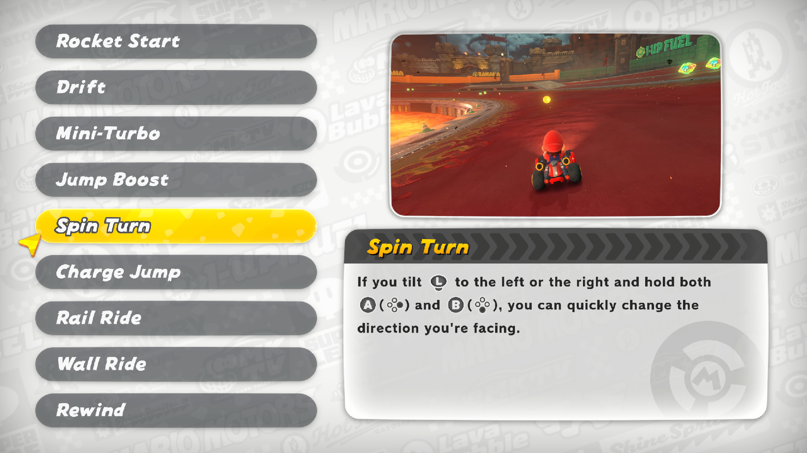
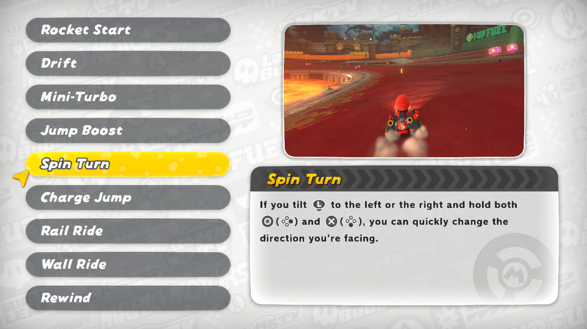
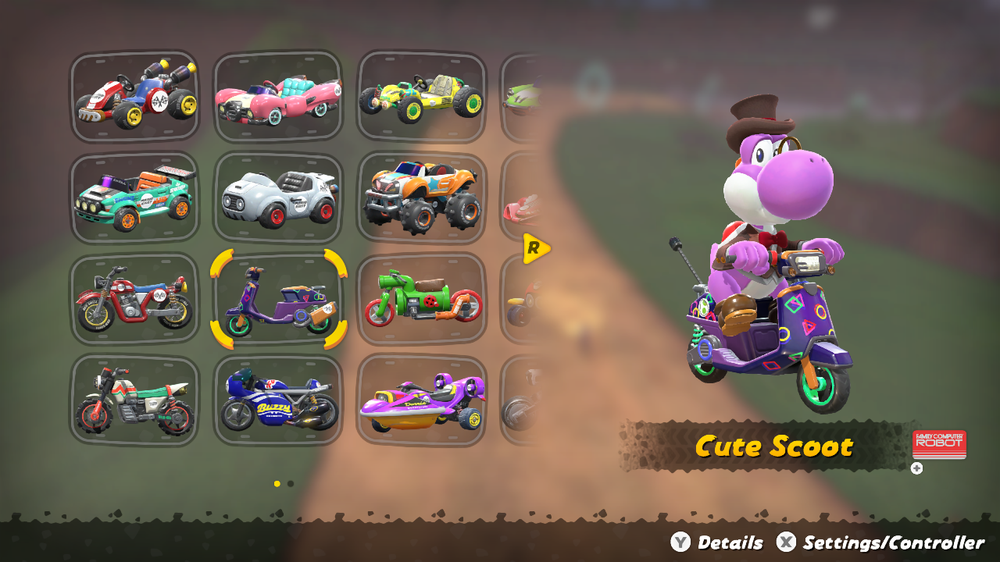
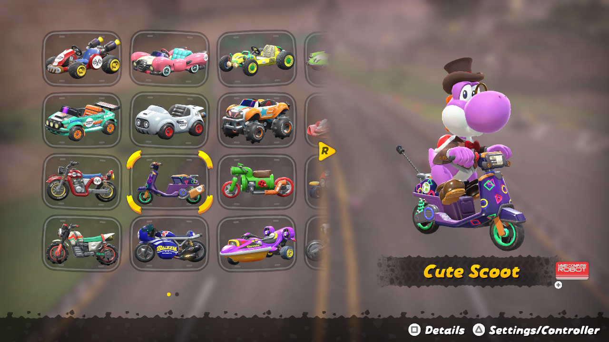

# Mario Kart World: Simple PlayStation Icons

A mod that replaces the default Nintendo Switch 2 button prompts with PlayStation-style icons in **Mario Kart World**. Perfect for anyone playing with a PlayStation controller on emulator.

A/B buttons, before and after:

X/Y buttons, before and after:

The mod file is in this repo under `mod/` and ships in the release zip.

## About

Follows the same idea as [mkw-simple-xbox-icons](https://github.com/SavageCore/mkw-simple-xbox-icons): swap the Nintendo face button icons (A/B/X/Y) with their PlayStation equivalents, so on-screen prompts match the physical layout of your PlayStation controller.

The buttons keep their **original positions** - only the glyph art is replaced (A→○, B→✕, X→△, Y→□).

Prefer Xbox buttons? See [mkw-simple-xbox-icons](https://github.com/SavageCore/mkw-simple-xbox-icons).

## Download

- 🍌 **GameBanana** _(primary)_ - TBD
- 📦 **[GitHub Releases](https://github.com/SavageCore/mkw-simple-playstation-icons/releases)**

## Installation (Eglantine)

Eglantine is an Eden fork with Switch 2 support: https://github.com/Djihads80/Eglantine

Title ID for Mario Kart World: `0400C3F00006E000`

1. Download the release zip.
2. In Eglantine, right-click the game → **Configure Game** → **Add-Ons** tab.
3. Click **Import Mod from ZIP** and select the downloaded zip.
4. Enable the mod and launch the game.

## Want to Make Your Own?

Check out the **[Icon Swap Guide](guides/GUIDE.md)** for the MKW-specific walkthrough, and [Running Switch Toolbox on Linux](guides/SWITCH-TOOLBOX-LINUX.md) for Bottles setup.

## Credits

- PlayStation glyph shapes adapted from [PlayStation Buttons (Kirby and the Forgotten Land)](https://gamebanana.com/mods/500049)
- Method from [mkw-simple-xbox-icons](https://github.com/SavageCore/mkw-simple-xbox-icons)
